# React.js Basics to Advance conteps

# ⚛️ React.js — Basic to Advanced

> A practical React.js revision guide covering the concepts commonly used in **real-world projects, interviews, and industry development**.

---

## 🧠 React Mental Model

React is a JavaScript library for building user interfaces using reusable components.

The most important mental model:

```text
State / Props
      ↓
  Component
      ↓
     UI
      ↑
User Interaction
      ↓
 State Update
      ↓
 React Re-render
```

### Core idea

> **UI = f(State)**

When state changes, React calculates the UI that should be displayed and updates the necessary parts of the interface.

---

# 📚 React Learning Roadmap

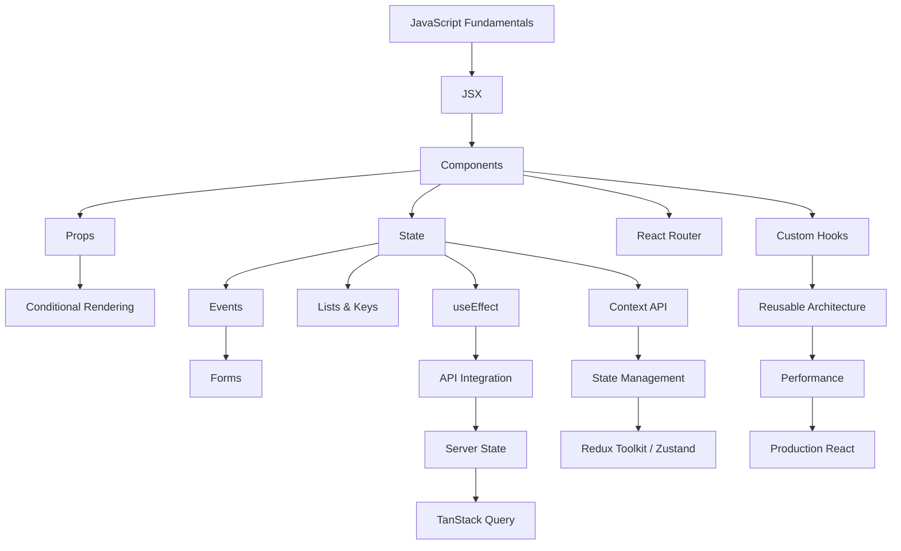

---

# 1. JSX

JSX allows us to write UI-like syntax inside JavaScript.

```jsx
const name = "Rifat";

function App() {
  return <h1>Hello {name}</h1>;
}
```

### Important

JSX is **not HTML**.

It is transformed into JavaScript by the React build toolchain.

```text
JSX
 ↓
Compiler / Transformation
 ↓
JavaScript
 ↓
React
 ↓
Browser
```

---

# 2. Components

A component is a reusable UI building block.

```jsx
function Button() {
  return <button>Click Me</button>;
}
```

Typical application structure:

```text
App
├── Navbar
├── Sidebar
├── Main
│   ├── ProductList
│   │   └── ProductCard
│   └── Pagination
└── Footer
```

### Why components?

- Reusability
- Maintainability
- Separation of responsibility
- Easier testing
- Scalable architecture

---

# 3. Props

Props are used to pass data from a parent component to a child component.

```jsx
<User name="Rifat" />
```

```jsx
function User({ name }) {
  return <h2>{name}</h2>;
}
```

### Props vs State

| Props                   | State                |
| ----------------------- | -------------------- |
| Passed by parent        | Managed by component |
| Read-only               | Can change           |
| Component communication | Dynamic UI data      |
| External input          | Internal state       |

---

# 4. State

State represents data that can change during the lifetime of a component.

```jsx
const [count, setCount] = useState(0);
```

Update state:

```jsx
setCount((prev) => prev + 1);
```

### Important Rule

Never mutate state directly.

❌

```js
user.name = "Rifat";
```

✅

```js
setUser((prev) => ({
  ...prev,
  name: "Rifat",
}));
```

---

# 5. Events

React handles user interactions through event handlers.

```jsx
<button onClick={handleClick}>Click</button>
```

Common events:

```text
onClick
onChange
onSubmit
onKeyDown
onMouseEnter
onScroll
```

Typical flow:

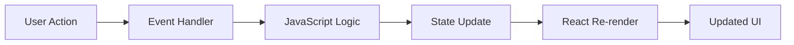

---

# 6. Conditional Rendering

Render different UI depending on state.

### Ternary

```jsx
{
  isLoggedIn ? <Dashboard /> : <Login />;
}
```

### Logical AND

```jsx
{
  isLoading && <Spinner />;
}
```

Typical production states:

```text
Loading
Success
Empty
Error
```

---

# 7. Lists & Keys

Render arrays using `map()`.

```jsx
users.map((user) => <UserCard key={user.id} user={user} />);
```

### Why keys?

Keys help React identify which list items changed, were added, or removed.

Prefer stable unique IDs:

```jsx
key={user.id}
```

Avoid using array indexes as keys when the list can be reordered or modified.

---

# 8. Forms

Controlled input:

```jsx
const [email, setEmail] = useState("");

<input value={email} onChange={(e) => setEmail(e.target.value)} />;
```

Typical form flow:

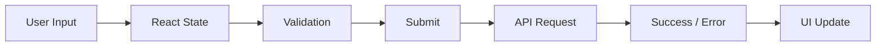

Important:

- Controlled components
- Uncontrolled components
- Validation
- Error handling
- Loading state
- Submit handling
- Form reset

---

# 9. useEffect

`useEffect` is mainly used to synchronize a component with an **external system**.

Examples:

- API requests
- Timers
- Event listeners
- WebSockets
- Browser APIs
- Subscriptions

```jsx
useEffect(() => {
  fetchUsers();
}, []);
```

### Dependency patterns

```jsx
useEffect(() => {
  // after renders
});
```

```jsx
useEffect(() => {
  // initial mount
}, []);
```

```jsx
useEffect(() => {
  // when userId changes
}, [userId]);
```

### Cleanup

```jsx
useEffect(() => {
  const timer = setInterval(() => {
    console.log("running");
  }, 1000);

  return () => {
    clearInterval(timer);
  };
}, []);
```

---

# 10. useRef

`useRef` stores a mutable value without causing a re-render when the value changes.

### DOM access

```jsx
const inputRef = useRef();

inputRef.current.focus();
```

Common use cases:

```text
DOM references
Timer IDs
Previous values
Imperative operations
External library instances
```

---

# 11. useMemo

Memoizes the result of an expensive calculation.

```jsx
const filteredProducts = useMemo(() => {
  return products.filter((product) => product.name.includes(search));
}, [products, search]);
```

Use it for actual performance needs, not everywhere.

---

# 12. useCallback

Memoizes a function reference.

```jsx
const handleDelete = useCallback(() => {
  deleteUser(id);
}, [id]);
```

Useful when passing callbacks to memoized child components.

---

# 13. React.memo

Prevents unnecessary rendering when props have not changed.

```jsx
const UserCard = React.memo(UserCardComponent);
```

Remember:

> `memo`, `useMemo`, and `useCallback` are optimization tools — not default requirements.

---

# 14. Re-rendering

A state update can cause a component to render again.

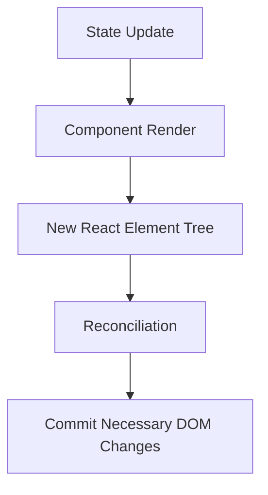

Important:

> **Re-render does not mean the entire DOM is recreated.**

---

# 15. Reconciliation

React compares the previous UI representation with the new one and determines what needs to change.

Important concepts:

```text
Element Type
Props
Position
Keys
Component Identity
```

Stable keys are particularly important for lists.

---

# 16. Lifting State Up

When multiple components need the same state, move that state to their closest common parent.

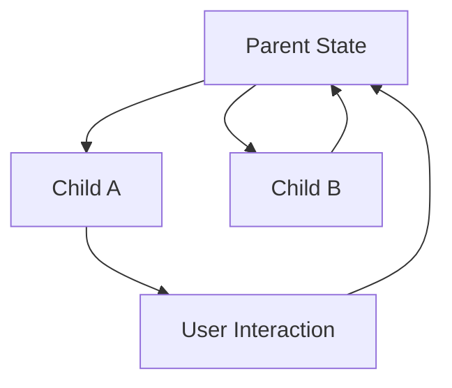

Example:

```text
Parent
├── SearchInput
└── ProductList
```

The search state can live in `Parent`.

---

# 17. Prop Drilling

Prop drilling happens when data has to travel through multiple components.

```text
App
 ↓
Page
 ↓
Section
 ↓
Card
 ↓
Button
```

Solutions depending on the situation:

```text
Better component structure
Context API
Custom Hooks
State management
```

---

# 18. Context API

Context allows data to be shared without passing props through every intermediate component.

Common use cases:

- Authentication
- Theme
- Language
- User preferences

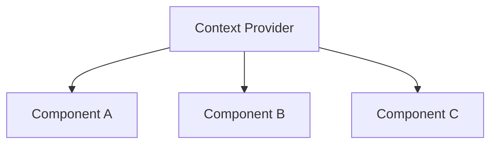

Context is useful, but it is not automatically the best solution for every global state problem.

---

# 19. Custom Hooks

Custom hooks allow reusable React logic.

```jsx
function useFetch(url) {
  // reusable fetching logic
}
```

Usage:

```jsx
const { data, loading, error } = useFetch("/api/users");
```

### Why custom hooks?

```text
Reusable Logic
      ↓
Custom Hook
      ↓
Multiple Components
```

Examples:

```text
useFetch()
useAuth()
useDebounce()
useLocalStorage()
useOnlineStatus()
useWebSocket()
```

---

# 20. React Router

Important concepts:

```text
Routes
Route
Link
NavLink
useNavigate
useParams
useSearchParams
Outlet
Nested Routes
```

Example:

```text
/
├── /about
├── /products
├── /products/:id
├── /login
└── /dashboard
```

---

# 21. Protected Routes

Frontend authentication flow:

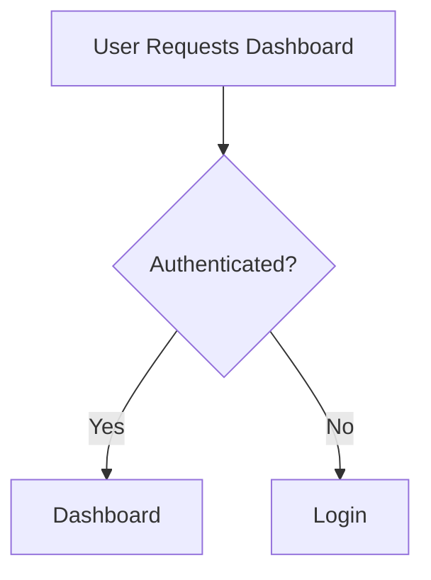

Important:

> Frontend route protection is not sufficient security.

The backend must verify authentication and authorization.

---

# 22. API Integration

One of the most important real-world React skills.

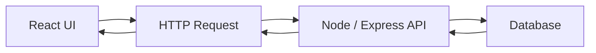

Know:

```text
GET
POST
PUT
PATCH
DELETE
```

HTTP status codes:

```text
200 OK
201 Created
400 Bad Request
401 Unauthorized
403 Forbidden
404 Not Found
500 Server Error
```

---

# 23. Async UI States

Production UI should handle more than just successful data.

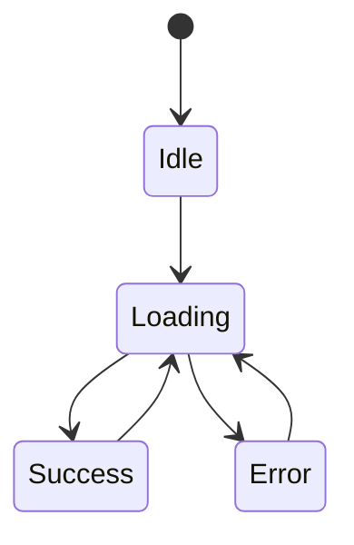

Typical UI:

```jsx
if (loading) return <Spinner />;
if (error) return <ErrorMessage />;
if (!users.length) return <EmptyState />;

return <UserList users={users} />;
```

---

# 24. Client State vs Server State

### Client State

State that belongs mainly to the UI.

```text
Modal
Theme
Selected Tab
Sidebar
Form UI
```

### Server State

Data that comes from a backend.

```text
Users
Products
Posts
Comments
Orders
Messages
```

Modern applications often use specialized server-state tools such as **TanStack Query**.

---

# 25. State Management

Typical progression:

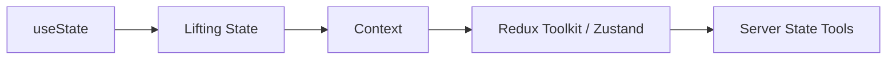

Do not put every piece of state into a global store.

Keep state as close as reasonably possible to where it is used.

---

# 26. Redux Toolkit

Important concepts:

```text
Store
Slice
Reducer
Action
Dispatch
Selector
Middleware
Async Logic
```

Flow:

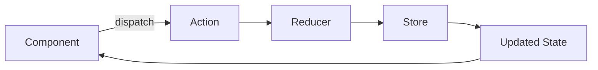

---

# 27. useReducer

Useful when local state has complex transitions.

```jsx
const [state, dispatch] = useReducer(reducer, initialState);
```

Example state:

```text
idle
loading
success
error
retry
reset
```

---

# 28. Performance Optimization

Important concepts:

```text
React.memo
useMemo
useCallback
Lazy Loading
Code Splitting
Virtualization
Stable Keys
State Placement
Avoiding unnecessary work
```

### Golden rule

```text
Measure
   ↓
Find bottleneck
   ↓
Optimize
   ↓
Measure again
```

Don't optimize blindly.

---

# 29. Lazy Loading & Code Splitting

Load code when it is actually needed.

```jsx
const Dashboard = lazy(() => import("./Dashboard"));
```

Then:

```jsx
<Suspense fallback={<Spinner />}>
  <Dashboard />
</Suspense>
```

Useful for large applications.

---

# 30. Suspense

Suspense provides a boundary for content that is waiting for something.

```jsx
<Suspense fallback={<Loading />}>
  <Dashboard />
</Suspense>
```

Modern React applications and frameworks use Suspense as part of their rendering architecture.

---

# 31. Error Boundaries

Error boundaries provide fallback UI when certain rendering errors occur in a component subtree.

```text
App
├── Navbar
├── Main ← Error
└── Footer
```

Instead of allowing one UI section to break the entire experience, an error boundary can display fallback UI.

---

# 32. Stale Closures 🔥

A very important JavaScript + React concept.

```jsx
useEffect(() => {
  setTimeout(() => {
    console.log(count);
  }, 3000);
}, []);
```

The callback may capture a value from an older render.

To understand stale closures, understand:

```text
JavaScript Closures
        +
React Render Cycle
        +
State Snapshots
```

---

# 33. Functional State Updates

When the next state depends on the previous state:

```jsx
setCount((prev) => prev + 1);
```

This is safer than relying on a potentially stale `count` value.

Example:

```jsx
setCount((prev) => prev + 1);
setCount((prev) => prev + 1);
```

---

# 34. Authentication vs Authorization

### Authentication

> Who are you?

```text
Login
 ↓
Identity
 ↓
Session / Token
```

### Authorization

> What are you allowed to do?

```text
User
 ↓
Role / Permission
 ↓
Allowed Action
```

Example:

```text
User → Read Posts
Admin → Read + Delete Posts
```

---

# 35. React Security Basics

Understand:

```text
XSS
CSRF
CORS
Authentication
Authorization
Token Handling
Input Validation
HTTPS
Secure API Design
```

Important:

> Never treat frontend validation as your only security layer.

The backend must validate and authorize requests.

---

# 36. Environment Variables

Useful for configuration:

```text
API URL
Public configuration
Environment-specific settings
```

But:

> **Frontend environment variables are not secret.**

If a value is shipped to the browser, users can potentially inspect it.

Never put private backend secrets in client-side code.

---

# 37. Accessibility

Professional React applications should be accessible.

Know:

```text
Semantic HTML
Labels
Keyboard Navigation
Focus Management
ARIA
Alt Text
Color Contrast
Screen Reader Basics
```

Prefer:

```jsx
<button onClick={submit}>Submit</button>
```

over:

```jsx
<div onClick={submit}>Submit</div>
```

---

# 38. Testing

Understand the three major levels:

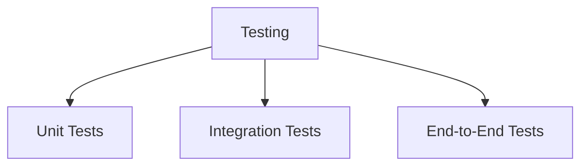

Common ecosystem:

```text
Vitest / Jest
React Testing Library
Playwright / Cypress
```

Test user behavior rather than implementation details whenever practical.

---

# 39. Component Architecture

A scalable React project might look like:

```text
src/
├── components/
├── pages/
├── layouts/
├── features/
├── hooks/
├── services/
├── utils/
├── store/
├── context/
├── routes/
└── assets/
```

The exact folder structure is less important than:

```text
Clear Responsibility
        +
Low Coupling
        +
Reusable Logic
        +
Maintainability
```

---

# 40. Reusable Components

Example:

```jsx
<Button variant="primary" loading={loading}>
  Create Account
</Button>
```

The same component can be reused across:

```text
Login
Register
Dashboard
Checkout
Profile
Admin Panel
```

---

# 41. Compound Components

Advanced reusable component pattern:

```jsx
<Tabs>
  <Tabs.List>
    <Tabs.Tab />
  </Tabs.List>

  <Tabs.Panel />
</Tabs>
```

Useful for building reusable UI systems and component libraries.

---

# 42. HOC & Render Props

Older but useful interview concepts.

### HOC

```text
Component
    ↓
Higher Order Component
    ↓
Enhanced Component
```

Example:

```jsx
withAuth(Component);
```

### Render Props

A component receives a function that controls rendering.

Modern React often uses **custom hooks** instead of these patterns for reusable logic, but understanding them is useful for legacy code and interviews.

---

# 43. Modern React Concepts

At an advanced level, understand the ideas behind:

```text
Concurrent Rendering
Transitions
Suspense
Automatic Batching
Server Components
Client Components
Streaming
Hydration
Server Rendering
```

You don't need to memorize implementation internals initially.

Focus on:

> **What problem does this feature solve?**

---

# 44. React + Next.js Architecture

React itself and Next.js are different.

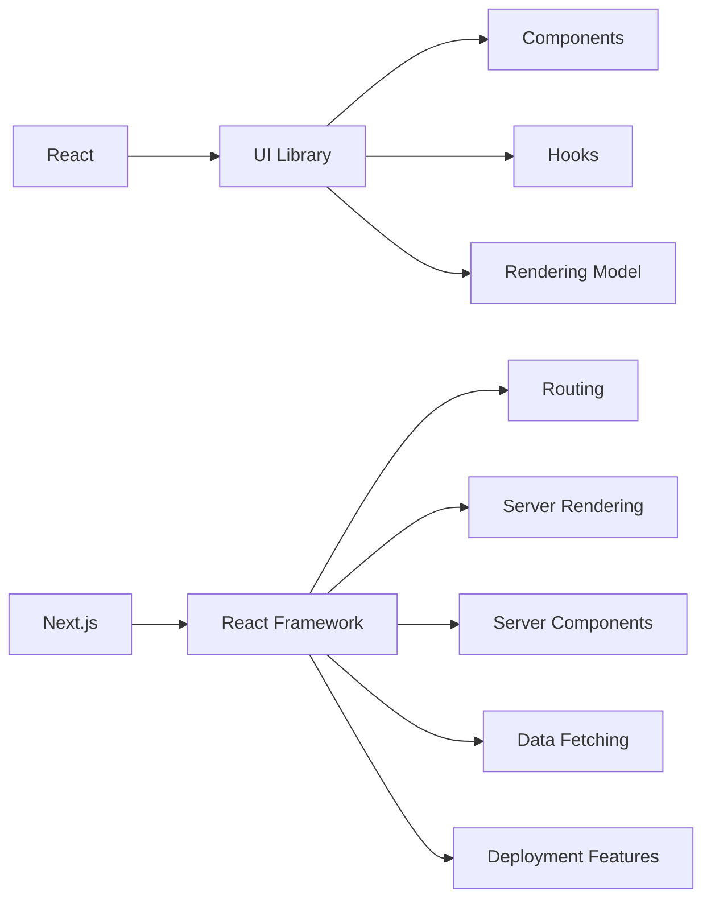

This distinction becomes important when moving from React to modern full-stack development.

---

# 45. Debugging Workflow 🔥🔥🔥

A strong developer does not immediately search for the answer.

Use this process:

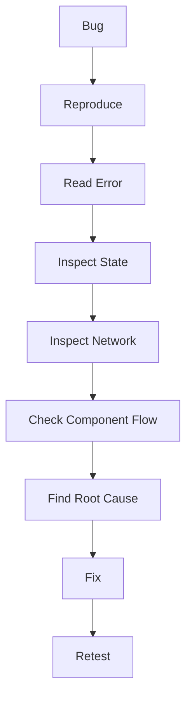

Tools:

```text
Console
Browser DevTools
Network Tab
Sources
Breakpoints
React DevTools
Network Requests
API Responses
Stack Traces
```

---

# 46. Real-World Feature Development

When you receive a new feature:

> "Build a search system."

Don't immediately write code.

Think:

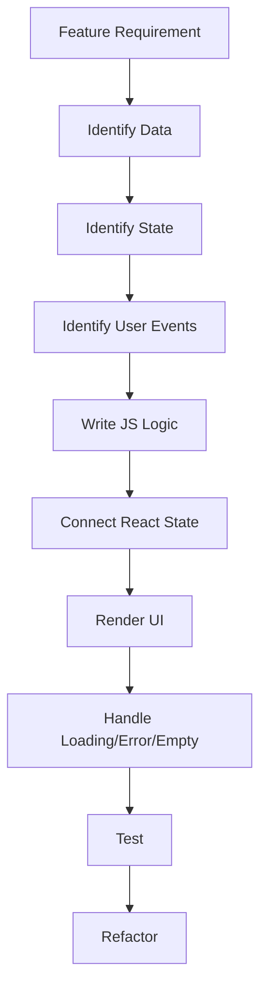

Example:

```text
Search Feature

Input
 ↓
search state
 ↓
debounce
 ↓
API request
 ↓
loading
 ↓
response
 ↓
filter/display
 ↓
empty/error state
```

---

# 47. React + JavaScript Skill Connection

React mastery depends heavily on JavaScript.

You should be comfortable with:

```text
Variables
Functions
Scope
Closures
Objects
Arrays
Destructuring
Spread Operator
Rest Operator
map()
filter()
find()
some()
every()
reduce()
findIndex()
includes()
Promises
async/await
Fetch
Modules
Events
DOM
Error Handling
```

Especially:

```js
map();
filter();
find();
reduce();
```

These appear constantly in React applications.

---

# 48. Interview Questions Checklist

## Beginner

- What is React?
- Why React?
- What is JSX?
- What is a component?
- What are props?
- What is state?
- Props vs state?
- What is conditional rendering?
- Why are keys needed?
- What is event handling?

## Intermediate

- How does `useState` work?
- Why shouldn't state be mutated directly?
- What is `useEffect`?
- When should you use `useEffect`?
- What is cleanup?
- What is `useRef`?
- What is lifting state up?
- What is prop drilling?
- What is Context API?
- What are custom hooks?
- How does React Router work?
- How do you handle API loading/error states?

## Advanced

- What causes a React component to re-render?
- What is reconciliation?
- Why are keys important?
- What is stale closure?
- What is batching?
- When should you use `useMemo`?
- When should you use `useCallback`?
- What is `React.memo`?
- What is code splitting?
- What is lazy loading?
- What is Suspense?
- What are Error Boundaries?
- Client state vs server state?
- Redux vs Context?
- What is virtualization?
- What are Server Components?
- CSR vs SSR vs SSG?
- What is hydration?

---

# 🏗️ Industry React Architecture

A typical full-stack application:

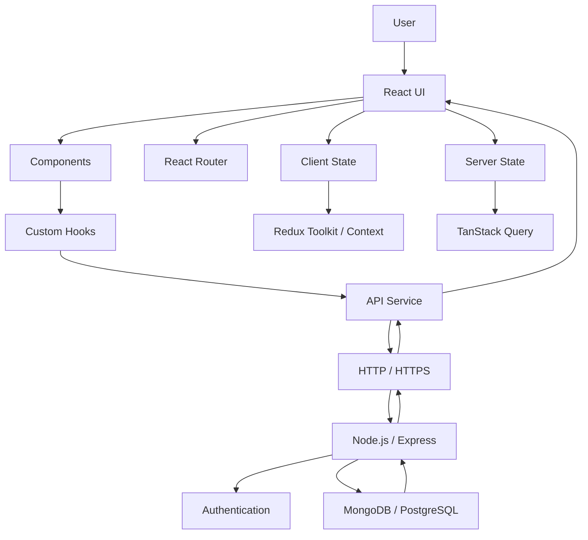

---

# 🚀 React Job-Ready Skill Map

```text
                    REACT DEVELOPER
                          │
        ┌─────────────────┼─────────────────┐
        ↓                 ↓                 ↓
   JavaScript          React Core       UI Development
        │                 │                 │
   ES6+              Components           HTML
   Async JS           Props               CSS
   Closures           State               Responsive UI
   Arrays             Events              Accessibility
   Objects            Hooks
        │                 │
        └──────────┬──────┘
                   ↓
             Data & API
                   │
          ┌────────┼────────┐
          ↓        ↓        ↓
        REST     Auth     Forms
          │        │        │
          └────────┼────────┘
                   ↓
             State Management
                   │
          Context / Redux
          Query / Cache
                   ↓
             Architecture
                   │
       Components / Hooks
       Services / Features
                   ↓
              Performance
                   │
        Memoization / Lazy
        Virtualization
                   ↓
               Testing
                   │
        Unit / Integration / E2E
                   ↓
              Production
                   │
       Git / Build / Deploy
```

---

# 🧪 Practice Projects

Use projects to turn concepts into actual skills.

### Level 1

```text
Counter
Todo App
Calculator
Form Validator
Notes App
```

### Level 2

```text
Movie Search App
Weather Dashboard
Product Filter
Pagination
Shopping Cart
Authentication UI
```

### Level 3

```text
E-commerce
Admin Dashboard
Task Management App
Real-time Chat
Social Media App
```

### Full-Stack

```text
React
  ↓
React Router
  ↓
State Management
  ↓
API
  ↓
Node.js
  ↓
Express
  ↓
MongoDB
  ↓
JWT Authentication
```

---

# 🧠 The Most Important React Mental Model

When building **any feature**, ask:

```text
1. What data do I have?
        ↓
2. What data can change?
        ↓
3. What state do I need?
        ↓
4. What user event happens?
        ↓
5. What JavaScript logic runs?
        ↓
6. What API is needed?
        ↓
7. What UI should change?
        ↓
8. What happens during loading?
        ↓
9. What happens on error?
        ↓
10. What happens when data is empty?
```

---

# 🔥 React Mastery Formula

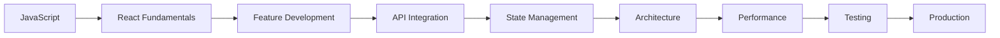

### The real goal

Don't aim to memorize every React API.

Aim to reach this level:

```text
New Feature
     ↓
Understand Requirement
     ↓
Break Problem Down
     ↓
Design State
     ↓
Write JavaScript Logic
     ↓
Build Components
     ↓
Connect API
     ↓
Handle Edge Cases
     ↓
Debug
     ↓
Optimize
     ↓
Ship
```

> **React skill = JavaScript logic + React mental model + component architecture + API/data handling + debugging.**

---

## ✅ Final Revision Checklist

- [ ] JSX
- [ ] Components
- [ ] Props
- [ ] State
- [ ] Events
- [ ] Conditional Rendering
- [ ] Lists & Keys
- [ ] Forms
- [ ] `useState`
- [ ] `useEffect`
- [ ] Cleanup
- [ ] `useRef`
- [ ] `useMemo`
- [ ] `useCallback`
- [ ] `React.memo`
- [ ] Re-rendering
- [ ] Reconciliation
- [ ] Lifting State
- [ ] Prop Drilling
- [ ] Context API
- [ ] Custom Hooks
- [ ] React Router
- [ ] Protected Routes
- [ ] REST API
- [ ] Async UI
- [ ] Authentication
- [ ] Authorization
- [ ] Client vs Server State
- [ ] Redux Toolkit
- [ ] `useReducer`
- [ ] TanStack Query
- [ ] Lazy Loading
- [ ] Code Splitting
- [ ] Suspense
- [ ] Error Boundaries
- [ ] Performance
- [ ] Accessibility
- [ ] Testing
- [ ] Debugging
- [ ] Component Architecture
- [ ] Stale Closures
- [ ] Batching
- [ ] Server Components
- [ ] CSR / SSR / SSG
- [ ] Hydration
- [ ] Production Architecture

---

### 🎯 Target

**Beginner →** Can write React components

**Intermediate →** Can build features independently

**Job-ready →** Can build and debug real applications

**Advanced →** Can design scalable React architecture

**Strong Engineer →** Can understand _why_ the architecture works, not just _how_ to write the syntax.
